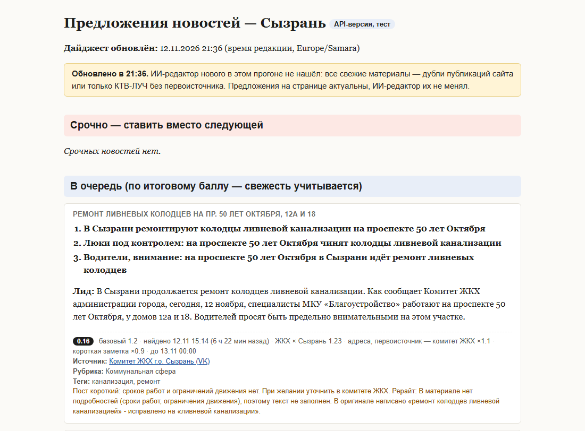
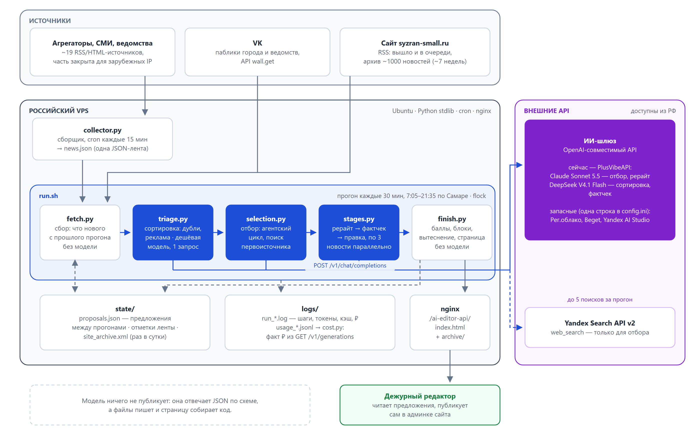
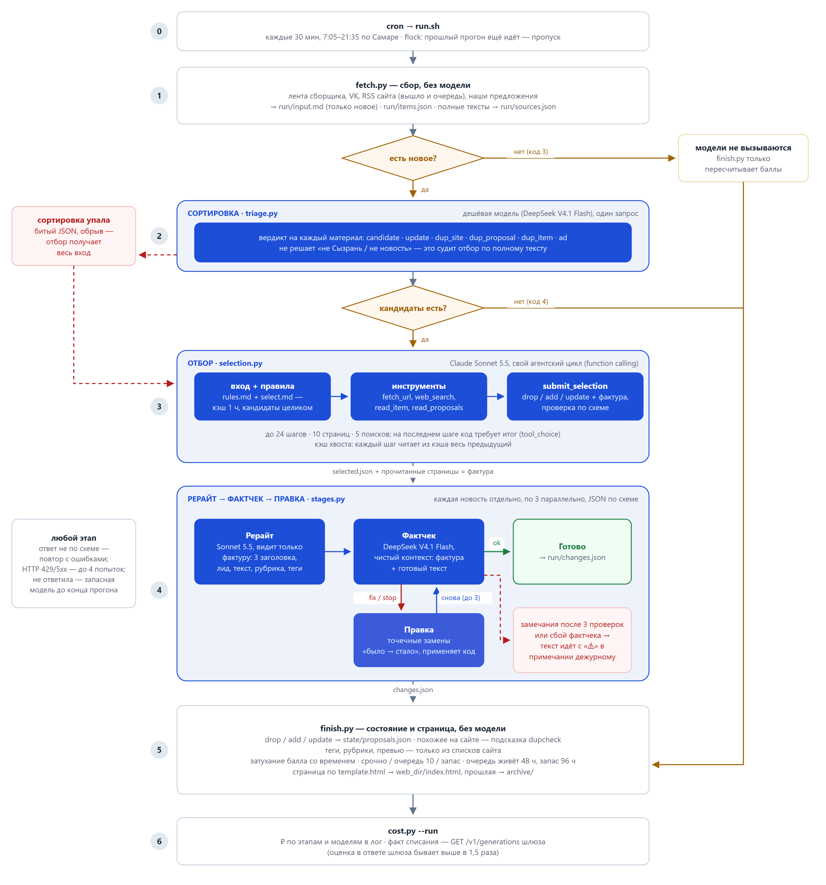
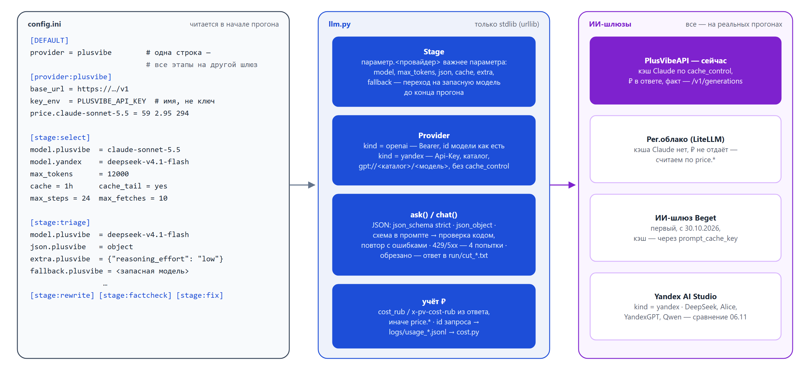

# ИИ-редактор на OpenAI-совместимом API

«Младший редактор» для городского новостного сайта [syzran-small.ru](https://www.syzran-small.ru) (Сызрань). Каждые полчаса он читает ленты источников, СМИ и паблики VK, отбирает новости про Сызрань, сверяет их с тем, что сайт уже выпустил, доходит до первоисточника, пишет три варианта заголовка, лид и текст, ставит рубрику, теги и превью. Отдельный ИИ-фактчекер сверяет каждый текст с первоисточником, ошибки исправляются точечно. Готовые предложения попадают на страницу для дежурного редактора. Сам ИИ-редактор на сайт ничего не публикует.

Это ответвление проекта [ai_editor](https://github.com/delffine/ai_editor) (начато 30.10.2026). Задача и правила редакции те же, другое устройство:

- **модели — через ИИ-шлюз с OpenAI-совместимым API**, а не через Claude Code по подписке;
- **всё на одном российском сервере**: зарубежный VPS не нужен, потому что шлюзы доступны из РФ;
- **у каждого этапа своя модель**, все модели меняются в одном файле `config.ini`, а шлюз — одной строкой;
- **агентский цикл отбора свой**: модель просит инструменты, наш код их исполняет;
- **расход в рублях виден по каждому запросу**.



## Стек

| Слой | Чем сделано |
|---|---|
| Модели | ИИ-шлюз с OpenAI-совместимым API (`/v1/chat/completions`): сейчас [PlusVibeAPI](https://plusvibeapi.ru), проверены также Рег.облако, ИИ-шлюз Beget и Yandex AI Studio. Отбор, рерайт и правка — Claude Sonnet 5.5, сортировка и фактчек — DeepSeek V4.1 Flash |
| Клиент API | `llm.py` на чистом `urllib`: этапы и провайдеры из `config.ini`, JSON-ответы по схеме с проверкой кодом, повторы, запасная модель, кэш промпта, учёт ₽ |
| Агентский цикл отбора | `selection.py`: function calling — `fetch_url`, `web_search`, `read_item`, `read_proposals`, `submit_selection` |
| Поиск | Yandex Search API v2 |
| Правила редакции | Markdown в системном промпте: `rules.md` (отбор, справочник первоисточников, баллы), `rewrite_rules.md` + `cats.md`, `tags.md`, `fotos.md` (стиль, рубрики, теги, банк превью сайта), `factcheck_rules.md`, `fix_rules.md`. Общие с ai_editor |
| Сбор новостей | сборщик `collector.py` на том же сервере (~19 RSS/HTML-источников, одна JSON-лента) + `social.py` (VK API) + RSS и архив сайта |
| Логика вокруг модели | Python stdlib: `fetch.py`, `triage.py`, `stages.py`, `finish.py`, `dupcheck.py`, `cost.py` |
| Хостинг | российский VPS (Ubuntu, Python 3.9+), cron, nginx. Без pip, без баз данных |

## Архитектура



Принцип тот же, что в ai_editor: **детерминированное делает Python, решения принимает модель.** Код собирает ленты, считает, что нового с прошлого прогона, ведёт состояние, пересчитывает баллы, вытесняет лишнее и собирает страницу. Модель сортирует новое, ищет первоисточник, решает, что предложить, убрать или обновить, пишет тексты и проверяет их. У модели нет доступа к shell и файлам: она отвечает JSON по схеме или вызывает наши инструменты, а файлы пишет код. `fetch_url` ходит только на публичные адреса, читает не больше 3 МБ и отдаёт модели текст без меню.

Почему отдельная версия, а не ещё один шаг в ai_editor. Claude Code работает только с зарубежного сервера (Anthropic недоступен с российских IP), а часть источников, наоборот, закрыта для зарубежных IP. Поэтому в ai_editor три сервера и обмен лентой между ними. Здесь шлюз доступен из РФ, так что сбор, модели и страница живут на одной машине. Цена этого — свой агентский цикл вместо готового Claude Code и собственный учёт денег.

## Прогон по шагам



**0. `run.sh` по cron** — каждые 30 минут с 7:05 до 21:35 по Самаре, каждый день. `flock` не даёт двум прогонам идти одновременно. Секреты подгружаются из `~/.config/ai-editor-api.env`, в модели они не попадают.

**1. `fetch.py`** собирает вход без модели: лента сборщика, VK, RSS сайта (что вышло и что стоит в очереди), наши прошлые предложения. В `run/input.md` идёт только новое с прошлого прогона, полные тексты — в `run/sources.json`. `dupcheck.py` ищет похожее в архиве сайта (~1000 новостей, около 7 недель) и подписывает под материалом «похоже на сайте». Если нового нет, модели не вызываются.

**2. Сортировка (`triage.py`)** — дешёвая модель, один запрос на весь вход. На каждый материал она ставит вердикт: кандидат, обновление нашего предложения, дубль сайта, дубль предложения, дубль внутри входа или реклама. Судить «не Сызрань» или «не новость» ей не дано: это решает отбор по полному тексту, потому что дешёвая модель отсеивала нужное. Если сортировка упала, отбор получает весь вход.

**3. Отбор (`selection.py`)** — сильная модель в агентском цикле. Системный промпт — `rules.md` + `select.md`: он неизменен и кэшируется на час. Модель читает кандидатов, ходит на страницы первоисточников и в поиск, сдаёт итог вызовом `submit_selection`: что убрать, что добавить, что обновить, балл, блок и фактуру по каждой новости. Итог проверяется по схеме, при ошибке модель получает список ошибок и сдаёт заново. Лимиты задаются в `config.ini`: 24 шага, 10 страниц, 5 поисков. На последнем шаге код требует итог (`tool_choice`). Каждый шаг ставит метку кэша на конец диалога, и следующий шаг читает из кэша весь предыдущий.

**4. Рерайт → фактчек → правка (`stages.py`)** — по каждой новости отдельно, три параллельно, без инструментов, ответ строго JSON по схеме. Рерайтер видит только фактуру. Фактчекер — другая модель с чистым контекстом: фактура и готовый текст. При вердикте `fix` модель правки присылает точечные замены «было → стало», применяет их код, и текст проверяется снова, до трёх раз. Если замечания остались или фактчек сорвался, текст всё равно идёт к редактору с пометкой «⚠» в примечании: готовый рерайт не теряется.

**5. `finish.py`** — состояние и страница без модели. Предложения хранятся между прогонами в `state/proposals.json`. Теги, рубрики и превью берутся только из списков сайта. Балл затухает со временем, блоки — «Срочно», «В очередь» (до 10) и «Запас». Очередь живёт 48 часов, запас — 96. Страница собирается по `template.html`, прошлая уходит в `archive/`. Если этап упал, страница всё равно обновляется: с причиной и прошлыми предложениями. Отметки ленты при этом не сдвигаются, и пропущенное разберёт следующий прогон.

**6. `cost.py --run`** пишет в лог расход по этапам и моделям.

## Модели и провайдеры



Всё, что касается моделей, лежит в [`runner/config.ini.dist`](runner/config.ini.dist), в коде ни моделей, ни цен нет. Файл читается в начале каждого прогона, перезапуск не нужен.

- `[provider:имя]` — адрес шлюза, имя переменной с ключом, тайм-аут, цены `price.<модель>` (на случай, если шлюз не сообщает стоимость сам). `kind = openai` — обычный OpenAI-совместимый шлюз, `kind = yandex` — Yandex AI Studio со своей авторизацией и адресацией моделей.
- `[stage:triage|select|rewrite|factcheck|fix]` — модель, `max_tokens`, режим JSON (`schema` / `object` / `prompt`), кэш, `extra` (например, `reasoning_effort`), запасная модель `fallback`.
- Любой параметр этапа можно задать под провайдера: `model.yandex = …` важнее `model = …`, когда выбран `yandex`. Поэтому переход всех этапов на другой шлюз — это одна строка `provider` в `[DEFAULT]`.

Что пришлось учесть, потому что шлюзы ведут себя по-разному:

- **JSON.** `json_schema strict` поддерживают не все модели (у DeepSeek на PlusVibe его нет, у Qwen на Рег.облаке — HTTP 400). Тогда `json = object`: схема уходит в промпт, ответ проверяет код. Ответ не по схеме — повтор со списком ошибок.
- **Скрытые рассуждения.** DeepSeek тратит `max_tokens` на рассуждения, которых не видно в ответе, и итог обрезался. Помогают `reasoning_effort: low` и запас по `max_tokens`. Обрезанный ответ сохраняется в `run/cut_*.txt` для разбора.
- **Кэш.** Для Claude кэш задаётся `cache_control` на системном промпте и на конце диалога. Через один шлюз он работал, через другой — нет при любых настройках. Ещё помогает постоянный `prompt_cache_key` на этап (совет поддержки Beget: их провайдер раскидывает запросы по серверам с отдельным кэшем). На PlusVibe в отборе из кэша читается до 92% входа.
- **Стоимость.** Шлюз отдаёт `cost_rub` в ответе, но у PlusVibe это оценка: у одной модели несколько маршрутов с разной ценой. `cost.py` сверяет каждый запрос с фактическим списанием (`GET /v1/generations`, по id запроса). За один день оценка дала 96 ₽, а списано 68.
- **Сбои.** На HTTP 429/5xx — до четырёх попыток с паузой. Если модель так и не ответила, этап до конца прогона переходит на запасную (`fallback`). Если модель отклонила необязательный параметр (`prompt_cache_key`, метку кэша на конце диалога), код отключает его до конца прогона.

## Как выбирали модели

Модели сравнивались на одном и том же входе: сохранённый вход прогона прогонялся через разные модели на каждом этапе. Тексты оценивались вслепую, без имён моделей: лучший +3, годится +1, брак −1.

- **Yandex AI Studio** (DeepSeek, Alice, YandexGPT 5.1, Qwen; 06.11.2026) — тупик. У Alice и YandexGPT срабатывает фильтр контента на обычных городских новостях. Быстрые модели отбирали без проверки первоисточников. Полный прогон на DeepSeek стоил 64–95 ₽ по ценам Яндекса.
- **Дешёвые модели на рерайте** (Рег.облако, 10 новостей): по слепой оценке первыми шли GLM 5.3 Flash, MiniMax M3 и DeepSeek V4.1 Flash, разница между ними в пределах шума. Claude Sonnet 5.5 оказался в той же группе, не выше. Вторая оценка (другая модель как судья) дала тех же лидеров.
- **Отбор** — самый трудный этап: многошаговый поиск первоисточника и решение «брать или нет». Быстрые модели делали 1–2 шага без единой страницы или брали 4 новости из 10.
- **Сейчас:** на PlusVibe Sonnet стоит 59/294 ₽ за млн токенов, а чтение кэша в 20 раз дешевле входа. Поэтому отбор, рерайт и правка идут на Sonnet. Сортировка и фактчек — на DeepSeek V4.1 Flash (1,91/7,63 ₽), они стоят копейки. Бесплатную версию DeepSeek от шлюза пробовали: она то отвечала HTTP 502, то выдавала битый JSON, и от неё отказались.

## Цифры

Боевые прогоны на PlusVibe, по фактическому списанию:

| День | Прогонов | Переписано новостей | ₽ за день | из них отбор |
|---|---|---|---|---|
| 10.11.2026 | 30 | 24 | 57,4 | 41,5 |
| 11.11.2026 | 30 | 28 | 85,5 | 59,3 |
| 12.11.2026 | 30 | 21 | 70,3 | 55,6 |

В среднем около 70 ₽ в день, ~2,3 ₽ за прогон и ~3 ₽ за готовую новость. Три четверти расхода — отбор. В первый день (07.11) отбор при одном кандидате делал до 18 шагов: справочник первоисточников в `rules.md` он читал как список обхода и проходил ленты ведомств, которые и так есть во входе. После правки `select.md` («ленты не обходи») и лимита в 10 страниц расход упал примерно в 2,5 раза.

## Эксплуатация

- Лог прогона — `logs/run_ГГГГ-ММ-ДД.log`: шаги отбора с токенами, кэшем и ₽, вердикты фактчека, «стоимость прогона» по этапам. Диалог отбора целиком — `run/select_log.json`.
- Расход за день — `python3 cost.py ГГГГ-ММ-ДД`, пересчёт дня по факту шлюза — `python3 cost.py --fact ГГГГ-ММ-ДД`.
- Проверка шлюза — `python3 check.py`: ключ, модели, JSON-схема и кэш на каждом этапе, tool calling, поиск, лента, запись страницы. Список моделей шлюза — `python3 check.py models`.
- Песочница для сравнения: копия кода + `AI_EDITOR_CONFIG=/путь/config_b.ini`, `AI_EDITOR_DRY=1` (страница в `run/page.html`, состояние не трогается).

## Установка

Нужно: Python ≥ 3.9 (только stdlib), `curl`, `flock`, cron, nginx и JSON-лента сборщика (файл или URL).

```bash
# код: python pack.py --sync -> dist/ai_editor_api.tar.gz, распаковать в папку на сервере
tar xzf ai_editor_api.tar.gz -C /srv/ai_editor_api && cd /srv/ai_editor_api
cp config.ini.dist config.ini          # [run] feed = путь к ленте, web_dir = папка страницы

# секреты: ключ шлюза, ключ и каталог Yandex Search API, токен VK
mkdir -p ~/.config && cp ai-editor-api.env.example ~/.config/ai-editor-api.env
chmod 600 ~/.config/ai-editor-api.env && nano ~/.config/ai-editor-api.env

python3 check.py                       # всё ли отвечает
./run.sh; tail -50 logs/run_$(date +%F).log
```

nginx отдаёт папку `web_dir` (`location /ai-editor-api/ { root /var/www/html; }`, с `X-Robots-Tag: noindex`). cron, если часы сервера по Москве:

```
5,35 6-20 * * * /srv/ai_editor_api/run.sh
```

## Структура

```
├── README.md
├── pack.py               сборка архива для сервера (--sync — правила из ai_editor)
├── gitimg/               картинки README
└── runner/               код; на сервере раскладывается плоско
    ├── config.ini.dist   провайдеры, модели этапов, лимиты (рабочий — config.ini)
    ├── ai-editor-api.env.example   имена переменных с ключами
    ├── run.sh            прогон по cron
    ├── llm.py            клиент API: Stage, Provider, ask/chat, кэш, запасная модель, учёт ₽
    ├── tools.py          fetch_url, web_search, read_proposals
    ├── fetch.py, social.py, dupcheck.py   сбор входа, VK, похожее на сайте
    ├── triage.py + triage.md              сортировка
    ├── selection.py + select.md           отбор (агентский цикл)
    ├── stages.py                          рерайт → фактчек → правка
    ├── finish.py + template.html          состояние и страница
    ├── check.py, cost.py, update.sh       проверка, расход, обновление на сервере
    ├── textutil.py
    └── rules.md, rewrite_rules.md, factcheck_rules.md, fix_rules.md,
        cats.md, tags.md, fotos.md         правила редакции и справочники сайта (общие с ai_editor)
```

## Планы

- **Подключить предложения к админке сайта**, как в ai_editor: «Предложка (ИИ)» и кнопка «Принять для публикации». `finish.py` уже пишет ленту `run/feed.json`.
- **Каналы в MAX** вместо Telegram: с российского сервера Telegram недоступен, и из этой версии он убран.
- **Отбор подешевле.** На отбор уходят три четверти расхода. Кандидаты — DeepSeek, GLM, MiniMax, GPT 6 Luna. Luna через Рег.облако ходит в первоисточники, но на том же входе взяла 4 новости против 10 у DeepSeek. Нужны сравнения на нескольких днях, а не на одном входе.
